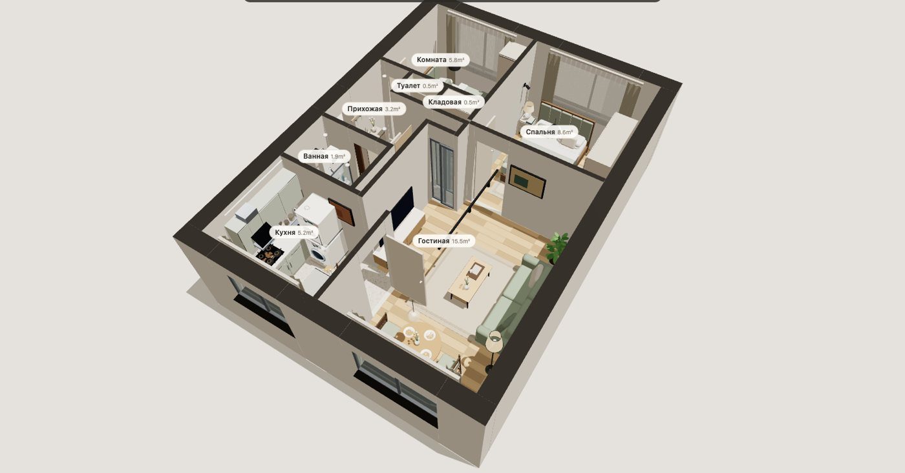
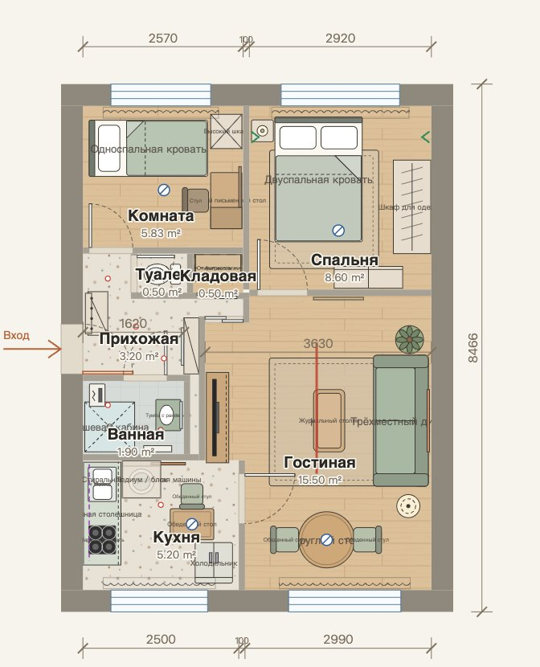
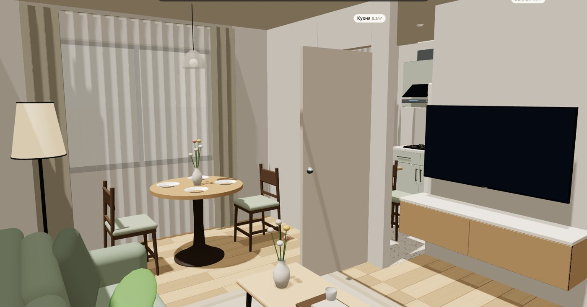
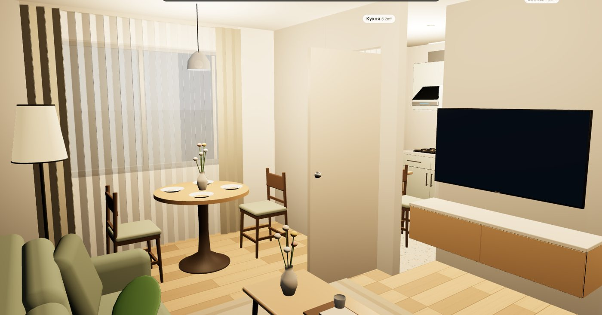

# kvartira-3d

План квартиры как JSON: редактор мебели в SVG и интерактивная сцена Three.js. Форк [floorplan-3d](https://github.com/wy51ai/floorplan-3d) с русским интерфейсом, сменными планировками, дополнительной мебелью и освещением, подложкой для обводки и клавишами, работающими в любой раскладке.

**Демо:** https://shulgin.is-a.dev/kvartira-3d/ — открывается в браузере, установка не нужна.



| План | Гостиная днём | Гостиная ночью |
| --- | --- | --- |
|  |  |  |

Встроенный пример — трёхкомнатная квартира серии ГИ, потолок 2,5 м. План восстановлен по фотографии с сохранением ортогональных стен и написанных размеров. Это интерпретация, а не обмерный чертёж. Для маленькой комнаты 2,57 × 2,27 м дают 5,8339 м² вместо подписанных 5,9 м²; остальные площади отличаются от подписей менее чем на 0,001 м². Проёмы, проход около санузлов и расстановка — приближённые; предположения записаны в `trace_notes` в JSON. Лестница не включена.

## Запуск и сборка

```sh
python3 build.py
python3 -m http.server 8000 --bind 127.0.0.1
```

Откройте `http://127.0.0.1:8000/`. Для загрузки файла по URL: `http://127.0.0.1:8000/?plan=plans/khrushchev-gi-3k.json`.

Сборка использует только стандартную библиотеку Python 3. `index.html` — готовый результат, его следует хранить в репозитории для GitHub Pages. Сборка сверяет SHA256 файла upstream, затем выполняет 64 замены с проверкой единственного совпадения. При изменении upstream она завершается ошибкой. Не редактируйте `index.html` вручную: исходники дополнений лежат в `src/`, неизменённые предоставленные модули — в `modules/`.

2D работает без загрузки библиотек. Для 3D браузер загружает **three@0.160.0** с jsDelivr, как в исходном проекте. Загрузка `?plan=...` требует HTTP; при открытии через `file://` используйте меню **Файл → Открыть планировку…**. Серверная часть и сборщик npm не нужны.

```sh
python3 tests/check.py
```

Проверяются воспроизводимость сборки, синтаксис двух скриптов через Node, данные, локализация, панели сметы на четырёх языках, обработчики 2D, построение архитектуры/мебели/света и координаты камеры на записывающих заглушках. Это не проверка настоящего WebGL, поэтому сцена отдельно проверена в Chromium без окна (WebGL через SwiftShader): русский интерфейс, план, общий вид, комнаты и ночной режим отрисовываются без ошибок в консоли. При запуске проверок создаётся `tests/offline.html` без сетевого 3D-модуля для локального просмотра 2D.

## Своя планировка

1. Скопируйте JSON примера и задайте уникальный постоянный `id`, например `my-flat`. Для другого объекта используйте другой ID.
2. Задайте стены, проёмы и полигоны помещений. Начало координат — **внутренняя грань левой и верхней наружных стен**, X направлен вправо, Y вниз. Геометрия в **миллиметрах**; высоты — **в метрах**. Наружные стены могут уходить в отрицательные координаты.
3. Откройте файл через меню. Подтвердите замену во встроенном диалоге: импорт заменяет геометрию, свет и мебель, очищает историю отмены. До замены текущее состояние сохраняется локально.
4. Расставляйте мебель, меняйте материалы, измеряйте расстояния. **Сохранить планировку** выгружает весь JSON с текущей мебелью, названиями, покрытиями, пометками демонтажа и измерениями. Сохраняются нестандартные свойства и метаданные.

Файловый импорт применяет содержимое файла. Загрузка через `?plan=` восстанавливает локальные изменения данного ID, если они есть. Для чистого открытия исходника используйте файловый импорт. Старые JSON исходного редактора, содержащие только `furniture` и состояние, тоже принимаются после подтверждения. Для «Восстановить исходную расстановку» базой служит активный загруженный план; действие можно отменить.

### Контракт JSON

| Поле | Формат |
| --- | --- |
| `id` | Рекомендуемый постоянный ID: латинские буквы, цифры, `_`, `-`, до 80 знаков. Без ID вычисляется хеш названия и геометрии. |
| `name`, `ceiling` | Название; высота потолка в м, от 2,2 до 6. |
| `walls` | Массив **прямоугольников**, не осевых линий: `[x0,y0,x1,y1,type]`. `x1>x0`, `y1>y0`; `b` — несущая, `e` — наружная, `n` — перегородка, `low` — низкая стенка. Обязателен непустой массив. |
| `windows` | Прямоугольники `[x0,y0,x1,y1,sill,head]`. `sill/head` — высота подоконника и верха окна в м. |
| `doors` | `{name,rect:[x0,y0,x1,y1],h:[hx,hy],c:[dx,dy],o:[dx,dy],len,entry?,door_head?}`. **`h` — точка петли в мм**, `c/o` — перпендикулярные единичные осевые направления закрытой/открытой створки; `len` — ширина в мм. `entry:true` определяет указатель и старт прогулки. Входной `o` направляйте внутрь квартиры. |
| `door_head` | Общая высота дверных проёмов в м, по умолчанию 2,1. Может быть переопределена у двери/раздвижного проёма. Створка ниже верха минимум на 0,07 м. |
| `slides` | `[{rect:[x0,y0,x1,y1],v:false,door_head?}]`; `v:true` для вертикального на плане проёма. |
| `rooms` | `[{id,name,poly:[[x,y],...],mat,at?:[x,y],counted?:false}]`. Непустые полигоны; ID уникальны. `at` — место подписи. `counted:false` сохраняет upstream-режим эркера/подоконной площадки. |
| `lights` | Форматы ниже. Пустой массив допустим. |
| `furniture` | `[{type,name,cx,cy,w,d,rot?,color?,...props}]`. Центр/ширина/глубина в мм, поворот в градусах по часовой стрелке; цвет `#rrggbb`. В локальной системе предмета передняя сторона направлена в `+Y`. |
| `dims` | Необязательный массив `{horiz:true,at:-700,start:0,segs:[2500,100,3000]}`. `at` — поперечная координата цепочки; `start` — начало вдоль оси; `segs` — длины в мм. Без поля рисуются общие габариты по наружным граням стен. |
| `editor` | Необязательное состояние `{demolished:["w3"],measures:[{a:{x,y},b:{x,y}}]}`. Индекс `w3` относится к `walls[3]`. Защищённые наружные/несущие стены не восстанавливаются из списка демонтажа. |

В стенах нужно **оставлять разрывы под проёмы**: окна и двери не вырезают отверстия в сплошном прямоугольнике автоматически. Внутреннюю отделку рисуют полигоны комнат. Материалы: `wood`, `walnut`, `tile800`, `tile600`, `marble`, `antislip`, `terrazzo`, `carpet`. Смета в RU/EN — **₽**, в zh/zht — исходные **¥**; подробности и ставки ниже.

Свет: `{"k":"spot","at":[x,y]}`; `pl` с тем же `at` — невидимый точечный источник; `{"k":"track","a":[x0,y0],"b":[x1,y1]}`; `{"k":"pendant","at":[x,y],"h":1.9}`; `{"k":"sconce","at":[x,y],"dir":[1,0],"h":1.6}`; `{"k":"led","pts":[[x0,y0],[x1,y1],...]}`. Треки и отрезки LED ортогональны. `h` в светильниках — высота в метрах; споты и LED привязаны к потолку. Видимые споты сами не создают точечных источников: для освещения добавьте `pl`.

Подвесы принимают `style:"glass"` (стеклянный плафон) или `style:"bar"` (линейный светильник). У `bar` поле `len` в **мм** (по умолчанию 1200), `vert:false` направляет его вдоль X, `vert:true` — вдоль Y плана. Пример: `{"k":"pendant","at":[1800,1200],"h":1.9,"style":"bar","len":1400,"vert":true}`. Бра принимает `style:"spot"` — чёрный поворотный спот. Без `style` сохраняется обычный плафон. Неизвестные стили, нечисловые длины и не-boolean `vert` отклоняются.

Дополнительные предметы: `hang1`, `hang2`, `oshelf`, `chest`, `topbox`, `hooks`, `boiler`, `washdry`, `tallcab`, `epanel`, `curtain`, `art`, `mirror`, `glassblock` и семь типов из таблицы. У `oshelf` — `led: "both" | "plus" | "minus"`; у `curtain` — `sheer: true/false`, `open: 0…0.5`; у `art`/`mirror` — `ht`, `y0` в **метрах**, `frame` как hex-цвет; у `art` также `c2`; у `glassblock` — `ht` в метрах. Стеклоблоки теперь вертикальные, в одном InstancedMesh; у `hang2` средняя стойка до потолка, у `hooks` — новые Г-образные крючки. Антресоли скрываются при срезе ниже 2,1 м.

| Тип / название в каталоге | Свойства JSON |
| --- | --- |
| `floatcab` — Подвесная тумба / Floating cabinet | `ht` (м, 0.4), `y0` (м, 0.35), `rows` (1), `hd` (`edge`), `top` — необязательный цвет столешницы |
| `drawers` — Комод на ножках / Dresser on legs | `ht` (м, 0.8), `legs` (м, 0.15), `humid` (boolean) — увлажнитель сверху; 2 × 3 ящика |
| `odesk` — Дубовый письменный стол / Oak desk | `w,d,color`; акриловая опора, тумба и монитор встроены |
| `gbox` — Подиум / блок / Podium / block | `ht` (м, 1), `y0` (м, 0); высота подиума от 0.01 м |
| `niche` — Ниша с полками / Shelved niche | `nw` (**мм**, 500), `nh` (м, 1.1), `ny0` (м, 1), `back` — цвет задника; четыре полки, короб до потолка |
| `towelrail` — Полотенцесушитель / Heated towel rail | `ht` (м, 1.4), `y0` (м, 0.3) |
| `rainshower` — Потолочный душ / Ceiling rain shower | `w` — диаметр в **мм**; задавайте `d=w` для круглого символа 2D |

Числа в скобках — значения по умолчанию. `tallcab` принимает `ht` в метрах (0.1–6; заданная высота ограничивается потолком в 3D), `rows` и `hd`. `rows` — целое 1–20, `hd` — `bar|edge|none`. `mirror.shape:"oval"` включает зеркало без рамы со свечением; без `shape` или с `"rect"` остаётся прямоугольное. У `vanity` можно задать `mirror:false`, чтобы заменить встроенное зеркало отдельным предметом `mirror`, как в ванной демо. Все цвета (`color`, `frame`, `c2`, `top`, `back`) — `#rrggbb`.

**Вертикальные свойства `ht`, `y0`, `legs`, `nh`, `ny0`, `lift` — метры; `cx`, `cy`, `w`, `d`, `nw` и `lights[].len` — миллиметры.** `lift` доступен у любого предмета и поднимает его целиком, дополнительно к `y0`; например, `lift:0.08` для техники на подиуме 80 мм. Адаптер создаёт копию с высотами в мм перед передачей модулям; исходный JSON, состояние, импорт и экспорт остаются в метрах. Вложенные модели `washdry` не получают повторный подъём. У `niche` нужны `nw<w`, `d>30` мм и `ny0+nh<ceiling`; ножки комода должны быть ниже `ht-0.02`. Сохраняются особенности исходных модулей: `niche.ny0:0` означает 1 м, а `towelrail.y0:0` — 0.3 м. Специальные свойства задаются в JSON; обычная панель редактирует размер, положение, поворот и цвет.

В демо появились подвесная ТВ-тумба, дубовый стол, комод, овальное зеркало и полотенцесушитель, подиум под стиральной колонной, стеклянные подвесы над столами и бра-споты у кровати. Палитра — тёплый дуб, приглушённый зелёный и нейтральный лён. Уже сохранённые расстановки не перезаписываются: чтобы увидеть обновлённый пример, импортируйте `plans/khrushchev-gi-3k.json` через меню или восстановите исходную расстановку.

### Смета покрытия — ориентировочно

RU и EN используют одни условные розничные ставки на 2026 год в **₽/м²**. Они заданы офлайн для предварительного планирования, без проверки магазинов и без пересчёта валют. zh/zht сохраняют исходные значения в CNY. Общая сумма и оценка комнаты = площадь × ставка × 1.05; включён запас 5%, без работ, доставки и подложки.

| ID | Принятое покрытие / material assumption | ₽/м² RU/EN | ¥/м² zh/zht |
| --- | --- | ---: | ---: |
| `wood` | Инженерная доска, дуб / engineered oak | 4500 | 320 |
| `walnut` | Инженерная доска, орех / engineered walnut | 6500 | 380 |
| `tile800` | Керамогранит 800 мм / porcelain tile | 2400 | 220 |
| `tile600` | Керамогранит 600 мм / porcelain tile | 1800 | 160 |
| `marble` | Натуральный мрамор / natural marble | 9500 | 650 |
| `antislip` | Нескользящая плитка 300 мм / anti-slip tile | 1600 | 140 |
| `terrazzo` | Плитка терраццо / terrazzo-look tile | 3200 | 280 |
| `carpet` | Ковролин / fitted carpet | 1500 | 200 |

### Камера для сценариев и видео

После загрузки движка включите 3D и режим обзора; дождитесь окончания перехода. Вызов `window.View3D.look(x, z, h, tx, tz, th)` ставит глаз в `(x,z)` плана на высоте `h` и направляет его на `(tx,tz)` на высоте `th`. Здесь `z`/`tz` — **Y плана**, координаты в **мм**, высоты `h`/`th` в **метрах**. Центр активной квартиры вычитается автоматически.

```js
await setView('3d'); // After the Three.js engine has loaded; use orbit mode.
window.View3D.look(4200, 6500, 1.6, 2160, 5000, 1.1);
```

Переход запрашивается на **10 мс**; это не Promise и не полный видеотур. Для серии кадров вызывайте `look` с разными координатами и дожидайтесь отрисовки перед снимком (например, 100 мс). В неактивном 3D вызов ничего не делает. `look` не включает 3D, не переключает режим прогулки, не проверяет столкновения и не меняет срез стен. Пользуйтесь им после перехода в обзор, без параллельного управления мышью.

Минимальный пример:

```json
{
  "id": "one-room",
  "name": "Моя комната",
  "ceiling": 2.5,
  "walls": [[-350,-350,3500,0,"e"],[-350,0,0,3000,"e"],[3500,-350,3850,3350,"e"],[-350,3000,3500,3350,"e"]],
  "windows": [],
  "doors": [],
  "slides": [],
  "rooms": [{"id":"room","name":"Комната","poly":[[0,0],[3500,0],[3500,3000],[0,3000]],"mat":"wood","at":[1750,1500]}],
  "lights": [{"k":"pendant","at":[1750,1500],"h":2.0}],
  "furniture": [{"type":"sofa","name":"Диван","cx":1750,"cy":2500,"w":1800,"d":800,"rot":180,"color":"#a9b8a2"}]
}
```

### Подложка

**Файл → Подложка…** → PNG, JPEG или WebP до 3 МБ → **Масштаб по двум точкам** → укажите на скане концы известного отрезка → введите его длину в мм. Первая точка останется на месте. Передвигайте изображение с **Alt + перетаскивание** либо кнопкой **Переместить подложку** (подходит для сенсорного экрана); Esc завершает режим. Есть прозрачность и показ/скрытие. При показе подложки покрытия полупрозрачны для сверки границ.

Геометрию стен редактируйте в JSON и открывайте его снова с тем же `id`, сравнивая с подложкой. Это инструмент сверки; интерактивное рисование новых стен и исправление перспективы скана не входят в редактор. Изображение и калибровка хранятся только в `localStorage` данного плана и не включаются в JSON-экспорт. При переполнении хранилища выводится сообщение; уменьшите исходный файл. Не используйте сканы с личными данными для публичных примеров.

Мебель, покрытия и измерения: `kvartira-3d:v1:<id>`. Подложка: суффикс `:underlay`, панели: `:panes`. Только выбор языка общий для приложения.

### Клавиши

| Клавиша | Действие |
| --- | --- |
| T | Переключить 2D / 3D |
| V / M / X | Выбор / измерение / демонтаж перегородок |
| F / Shift+F | Вписать план / полный экран |
| R / Shift+R | Поворот +90° / −90° |
| [ / ] | Каталог / свойства |
| + / − | Масштаб 2D; цифровой блок также работает |
| Стрелки / Shift+стрелки | Сдвиг мебели на 10 / 100 мм |
| Ctrl/⌘+Z / Ctrl/⌘+Shift+Z | Отменить / повторить |
| Ctrl/⌘+D / Delete | Дублировать / удалить |
| WASD / Shift | Движение / ускорение в прогулке |
| E | Дверь под прицелом (до 2,5 м); если такой нет — ближайшая к глазу в радиусе 2,2 м |
| Esc | Снять выделение, отменить измерение/подложку, пауза прогулки |

Буквенные клавиши и скобки обрабатываются через `KeyboardEvent.code`, поэтому работают в русской раскладке. В полях ввода и открытых диалогах редакторские сочетания отключены.

### Авторы и лицензии

- Исходный [floorplan-3d](https://github.com/wy51ai/floorplan-3d), **wuyi**, commit `730ec09`, MIT. Снимок и исходная лицензия в `vendor/`.
- Этот форк: **Aleksandr_NFA (Telegram) / Sanexxxx777 (GitHub)**. Код — MIT; см. [LICENSE](LICENSE).
- Изображение «[GI Planirovka 3K](https://commons.wikimedia.org/wiki/File:GI_Planirovka_3K.jpg)» — **Melee**, [CC BY-SA 3.0](https://creativecommons.org/licenses/by-sa/3.0/).
- Производные данные **`plans/khrushchev-gi-3k.json` распространяются по CC BY-SA 3.0**, отдельно от MIT-кода. Изменения: ортогональная реконструкция, метрические координаты, оценка проёмов, мебель и свет. Исходное изображение сохраняет CC BY-SA 3.0. Встроенная в `index.html` копия данных сохраняет эту же лицензию.

---

# English

**kvartira-3d** is a data-driven fork of [floorplan-3d](https://github.com/wy51ai/floorplan-3d): an SVG furniture editor and Three.js apartment viewer with orbit/walk modes, doors, sun/night, room areas, flooring estimates, undo/redo, PNG export, full-plan JSON exchange, additional furniture and lighting, and a calibrated image underlay. Russian is selected for a Russian browser locale unless a saved language preference exists. English, Simplified Chinese and Traditional Chinese remain available.

Live demo: https://shulgin.is-a.dev/kvartira-3d/ (runs in the browser, nothing to install).

## Build and run

```sh
python3 build.py
python3 tests/check.py
python3 -m http.server 8000 --bind 127.0.0.1
```

Open `http://127.0.0.1:8000/`. No build dependencies beyond Python 3; Node is used only by the checks. The generated `index.html` should be tracked for GitHub Pages. Upstream is pinned by SHA256 and all 64 patches require exactly one matching anchor. Sources live in `src/`; provided modules remain unchanged. The browser's 3D module still loads Three.js **0.160.0** from jsDelivr. 2D does not depend on that download.

`?plan=plans/khrushchev-gi-3k.json` fetches a relative file over HTTP. Only `plans/<letters-digits-underscores-hyphens>.json` paths are accepted. Local `file://` use can load JSON through **File → Open plan**. JSON replacement requires an in-page confirmation and clears undo history; it saves current local edits first. **Export plan JSON** saves the whole active plan and editor state. Legacy furniture-only upstream exports also work. File import applies file contents; URL loading restores existing edits for that ID. Reset restores the active plan's original furniture, materials and editor state and is undoable.

## Plan contract

Coordinates are **mm**, origin at the **inner faces of the left and top exterior walls**, X right, Y down. Heights are **metres**; rotations are clockwise degrees. Use a stable unique `id` to retain edits and underlays across geometry changes. Without one, a deterministic geometry/name hash is generated.

- `name`, `ceiling` (2.2–6 m), nonempty `walls` and `rooms` are required. `windows`, `doors`, `slides`, `lights`, `furniture` default to empty arrays.
- `walls`: `[[x0,y0,x1,y1,type]]`, positive-width rectangular solids; `b` bearing, `e` exterior, `n` partition, `low` low wall. **Leave gaps** for windows and doors: openings do not subtract from wall solids automatically.
- `windows`: `[[x0,y0,x1,y1,sill_m,head_m]]`.
- `doors`: `[{name,rect,h,c,o,len,entry?,door_head?}]`. `rect` is the opening rectangle; **`h` is the hinge point in mm**, not height. `c`/`o` are perpendicular axis-unit vectors for the closed/open leaf. `len` is mm. An entry door defines the marker and walk start; point its `o` inward.
- Global `door_head` defaults to 2.1 m; a door/slide can override it. Leaves remain at least 0.07 m below the head.
- `slides`: `[{rect,v,door_head?}]`, where `v` indicates a vertical opening on the plan.
- `rooms`: `[{id,name,poly,mat,at?,counted?}]`; polygon and label anchor use mm. `counted:false` retains upstream's bay-window/platform behavior. Material IDs: `wood`, `walnut`, `tile800`, `tile600`, `marble`, `antislip`, `terrazzo`, `carpet`. RU/EN estimates use **RUB**; zh/zht retain upstream **CNY** prices.
- `furniture`: `[{type,name,cx,cy,w,d,rot?,color?,...props}]`; `color` is `#rrggbb`, front points along local +Y. See the complete minimal JSON example above.
- `dims`: optional `[{horiz,at,start,segs}]`, all mm. Without it, overall chains use wall extents.
- Optional `editor`: `{demolished:["w3"],measures:[{a:{x,y},b:{x,y}}]}`. Wall IDs index `walls`; exterior/bearing entries are ignored when restoring demolition state.

Lights: `spot`/`pl` use `at`; `track` uses axis-aligned `a,b`; `pendant` uses `at,h`; `sconce` uses `at,h,dir`; `led` uses an orthogonal `pts` chain. Light `h` is metres. `pl` is invisible illumination; spots are emissive fixtures, so add a `pl` to illuminate a room.

Pendants accept `style:"glass"` or `"bar"`. A bar accepts `len` in **mm** (default 1200) and boolean `vert` (false: along plan X; true: along plan Y). Example: `{"k":"pendant","at":[1800,1200],"h":1.9,"style":"bar","len":1400,"vert":true}`. Sconces accept `style:"spot"` for a black swivel spot. Omit `style` for the original shade. Unsupported styles and malformed props are rejected.

Additional furniture types: `hang1`, `hang2`, `oshelf`, `chest`, `topbox`, `hooks`, `boiler`, `washdry`, `tallcab`, `epanel`, `curtain`, `art`, `mirror`, `glassblock`, plus the seven types below. `oshelf.led`: `both|plus|minus`; `curtain.sheer`: boolean, `.open`: 0–0.5; `art`/`mirror`: `ht,y0` **in metres**, `frame` hex color; `art.c2` is a second hex color; `glassblock.ht` is metres. Glass blocks use one InstancedMesh of vertical blocks, `hang2` has a center support to the ceiling, and hooks have the updated L shape. Overhead cabinets disappear below a 2.1 m cut.

| Type / English catalog name | JSON props (defaults) |
| --- | --- |
| `floatcab` — Floating cabinet | `ht` (0.4 m), `y0` (0.35 m), `rows` (1), `hd` (`edge`), optional worktop color `top` |
| `drawers` — Dresser on legs | `ht` (0.8 m), `legs` (0.15 m), boolean `humid` adds a humidifier; 2 × 3 drawers |
| `odesk` — Oak desk | `w,d,color`; integrated acrylic leg, pedestal and monitor |
| `gbox` — Podium / block | `ht` (1 m, minimum 0.01 m), `y0` (0 m) |
| `niche` — Shelved niche | `nw` (**500 mm**), `nh` (1.1 m), `ny0` (1 m), back color `back`; four shelves in a ceiling-height box |
| `towelrail` — Heated towel rail | `ht` (1.4 m), `y0` (0.3 m) |
| `rainshower` — Ceiling rain shower | `w` is the diameter in **mm**; set `d=w` for a circular 2D symbol |

`tallcab` accepts `ht` (0.1–6 m, explicit height capped at the ceiling in 3D), `rows` and `hd`. `rows` is an integer from 1 to 20; `hd` is `bar|edge|none`. `mirror.shape:"oval"` uses a frameless mirror with edge glow; omitted or `"rect"` keeps the rectangular model. `vanity.mirror:false` hides its built-in mirror so a separate oval mirror can replace it. All colors (`color,frame,c2,top,back`) must be `#rrggbb`.

**Vertical props `ht,y0,legs,nh,ny0,lift` are metres; `cx,cy,w,d,nw` and light `len` are millimetres.** Every item accepts `lift`, which raises its whole group in addition to `y0`. For example, `lift:0.08` places an appliance on an 80 mm plinth. Only the render-boundary copy uses module mm props; state, import and export retain metres. Recursive `washdry` children are neither converted nor lifted twice. Niche constraints: `nw<w`, `d>30` mm, `ny0+nh<ceiling`; dresser legs must be below `ht-0.02`. Supplied module semantics are retained: `niche.ny0:0` uses the 1 m default; `towelrail.y0:0` uses 0.3 m. Edit special properties in JSON; the normal panel edits size, position, rotation and color.

The demo adds a floating TV console, oak desk, dresser, bathroom oval mirror and towel rail, a plinth under the laundry stack, glass pendants above tables and bedside spot sconces. Warm oak, muted green and neutral linen remain the palette. Existing local layouts are preserved: import the demo JSON or reset to the original layout to see the revised furnishings.

## Flooring estimates

RU and EN use approximate **2026 RUB/m²** allowances, labelled «ориентировочно» in Russian. zh/zht keep the original CNY table. The bilingual table above lists all eight rates and material assumptions. These are offline planning estimates, not checked store prices or currency conversions. Totals and room estimates include **5% waste** and exclude labour, delivery and underlay. Rates are maintained in `src/flooring.js`.

## Camera hook for scripted tours and videos

After the 3D engine loads, enter 3D orbit mode and wait for its entry transition. Call `window.View3D.look(x, z, h, tx, tz, th)`: eye plan coordinates `(x,z)` and target `(tx,tz)` are **mm**; eye height `h` and target height `th` are **metres**. Here `z` means the plan's Y coordinate. The active plan center is subtracted automatically.

```js
await setView('3d'); // Engine must already be loaded; use orbit mode.
window.View3D.look(4200, 6500, 1.6, 2160, 5000, 1.1);
```

The hook schedules a **10 ms** `flyTo` transition, returns no completion Promise, and does nothing when 3D is inactive. For frame sequences, call it with successive poses and allow rendering before capturing (for example, 100 ms). It does not enter 3D, change walk mode or wall cuts, or perform collision checks. Avoid simultaneous mouse control and wait for entry animations before using it.

## Trace with an underlay

File → **Underlay…** accepts PNG/JPEG/WebP up to 3 MB. Choose **Calibrate two points**, click the ends of a known distance and enter mm. The first point stays fixed. Use **Alt-drag**, or **Move image** for touch input, to position the scan; Esc exits. Opacity and visibility controls help compare walls. Edit geometry in JSON and reopen with the same ID. There is no new wall-drawing or perspective-correction tool.

Underlays are local to this browser and plan ID, and are excluded from JSON export. A storage-quota warning means the image will not survive closing the page; use a smaller file. State keys are `kvartira-3d:v1:<id>`, with `:underlay` and `:panes` suffixes. Language is an application-wide preference.

## Shortcuts

Physical keys work in any keyboard layout: **T** 2D/3D; **V/M/X** select/measure/demolish; **F** fit; **Shift+F** fullscreen; **R/Shift+R** rotate ±90°; **[/]** library/properties; **+/−** zoom. Arrows nudge 10 mm (Shift: 100 mm); Ctrl/⌘+Z undo, Shift+Ctrl/⌘+Z redo, Ctrl/⌘+D duplicate, Delete remove. In walk mode: **WASD**, Shift to run, **E** for the aimed door within 2.5 m or, if no door is aimed at, the nearest opening center within 2.2 m of the eye. Esc pauses/exits the current operation. Editor shortcuts are ignored in inputs and open dialogs.

## Credits, licensing and limits

Upstream **floorplan-3d by wuyi**, commit `730ec09`, is MIT. Fork by **Aleksandr_NFA (Telegram) / Sanexxxx777 (GitHub)**; code is MIT with both copyright notices in [LICENSE](LICENSE).

The demo derives from **“GI Planirovka 3K” by Melee**, [Wikimedia Commons](https://commons.wikimedia.org/wiki/File:GI_Planirovka_3K.jpg), [CC BY-SA 3.0](https://creativecommons.org/licenses/by-sa/3.0/). **`plans/khrushchev-gi-3k.json`, its embedded copy, and the source image are CC BY-SA 3.0**, separate from the code license. Changes include the orthogonal trace, metric coordinates, inferred openings, furniture and lighting.

The demo excludes the stairwell and is an interpretation, not a survey. Room 2's printed dimensions yield 5.8339 m² despite its 5.9 m² label. Other areas match within 0.001 m²; ambiguous partitions, the hall passage and openings are documented in `trace_notes`. `tests/check.py` covers the logic offline; the 3D scene is also checked in headless Chromium (SwiftShader WebGL): Russian UI, 2D plan, overview, room views and night mode render with no console errors.
